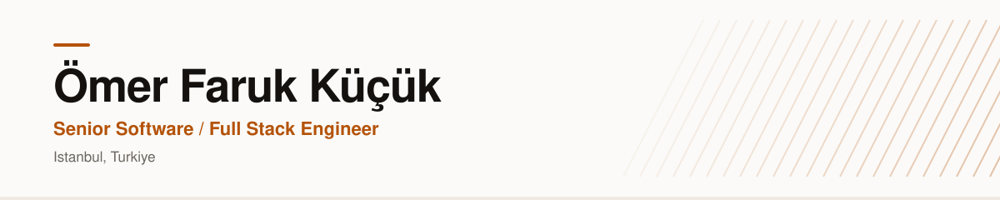

<picture>
  <source media="(prefers-color-scheme: dark)" srcset="assets/banner-dark.svg">
  
</picture>

Eight-plus years of building web products end to end. Most of my depth is on the frontend (React, Vue, Next.js, TypeScript), but the work I enjoy most sits at the seams: consolidating scattered repos into a monorepo so components stop getting copied, moving a PHP gateway onto Node so a team stops context-switching, keeping players in sync on a real-time server that has to stay up.

I care about the boring parts, too. Whether a codebase still loads fast in its third year, and whether someone joining next month can ship their first PR that same week.

## What I work with

**Frontend**

TanStack Query, Router and Table

**Backend and data**

**Tooling**

**AI-assisted**

Claude Code, MCP, Claude Skills, Copilot

## Currently

**Chissi**, a 3D multiplayer chess platform I'm building on my own. An NX monorepo holds a Laravel API, an authoritative Colyseus game server and a React 19 + Three.js client, with the game contracts typed once and shared across services. I build it on an AI-assisted workflow: Claude Code with custom Skills and MCP integrations for implementation, debugging and real-browser testing.

## Elsewhere

[LinkedIn](https://www.linkedin.com/in/ofk0)
